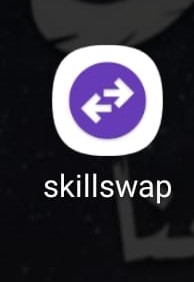
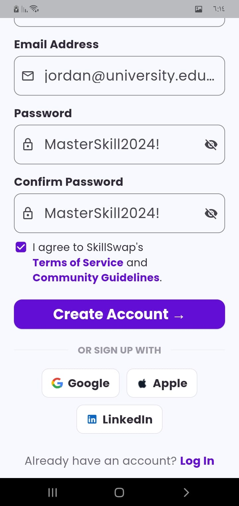
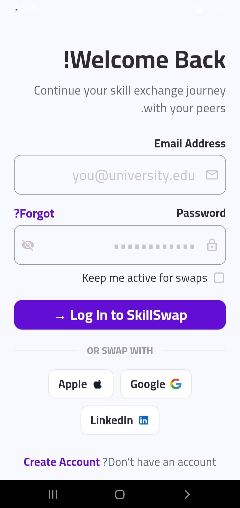
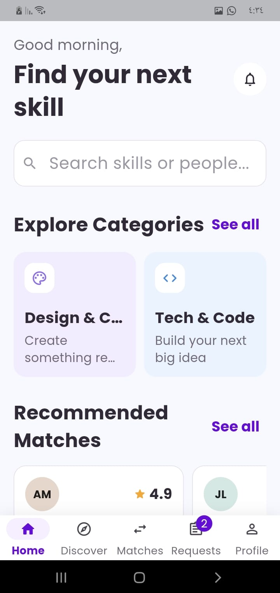
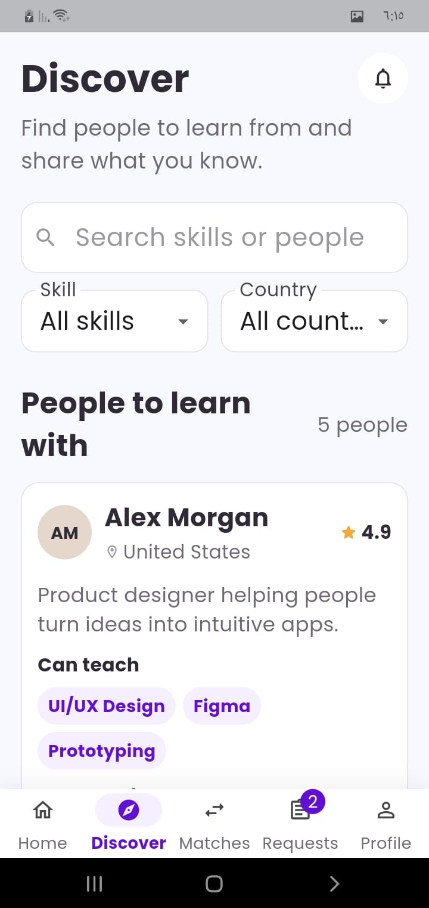
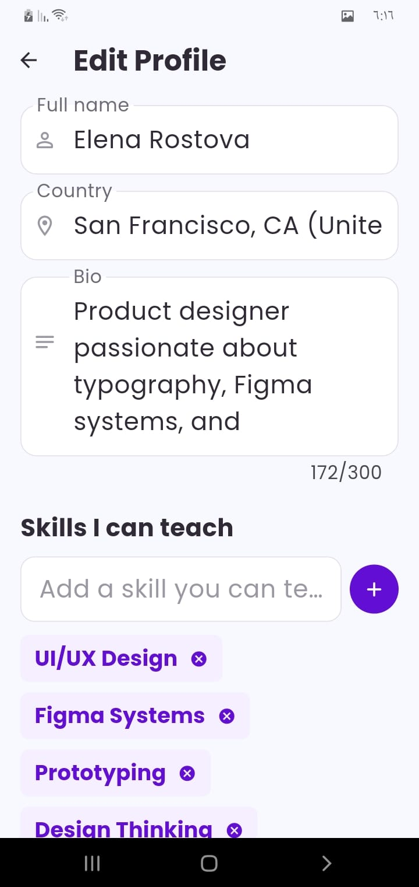
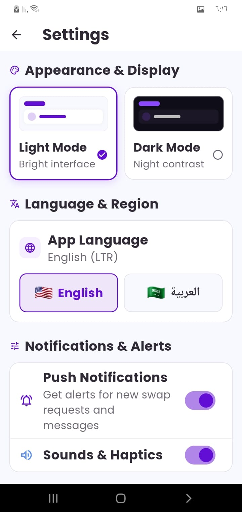
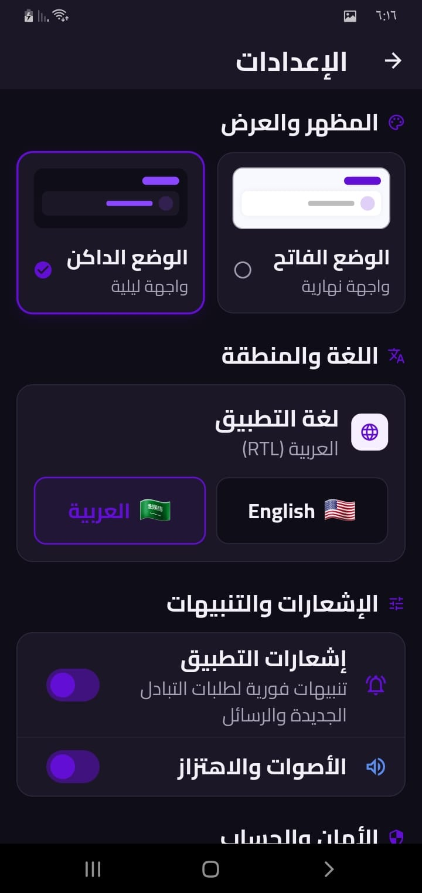

# 🔄 SkillSwap (تبادل المهارات)

**SkillSwap** هو تطبيق منصة تفاعلية تهدف إلى تمكين الأفراد والطلاب من تبادل المهارات والخبرات والمعارف بشكل مباشر. يتيح التطبيق للمستخدمين استكشاف مهارات جديدة، تعليم مهاراتهم الخاصة، والتواصل مع أقرانهم في مجالات مختلفة مثل التصميم، البرمجة، وغيرها.

---

## 📱 صور الشاشات (Screenshots)

<div align="center">

| أيقونة التطبيق | إنشاء حساب | تسجيل الدخول |
| :---: | :---: | :---: |
|  |  |  |

| الصفحة الرئيسية | استكشاف المهارات | تعديل الملف الشخصي |
| :---: | :---: | :---: |
|  |  |  |

| الوضع الفاتح (Light Mode) | الوضع الداكن (Dark Mode) | دعم اللغات (RTL / LTR) |
| :---: | :---: | :---: |
|  |  |  |

</div>

---

## ✨ المميزات الرئيسية

* **🔐 تسجيل الدخول وإنشاء الحساب:**
  * دعم تسجيل الدخول البريدي والإلكتروني (مستند لإيميل الجامعة/الكلية).
  * التسجيل المباشر عبر الحسابات الاجتماعية (Google, Apple, LinkedIn).

* **🔍 الاستكشاف والبحث (Discover):**
  * تصفح تصنيفات متعددة (Design & Creative, Tech & Code, إلخ).
  * فلترة المهارات حسب نوع المهارة (Skill) أو البلد (Country).
  * استعراض تقييمات وتخصصات المعلمين والأقران.

* **👤 إدارة الملف الشخصي (Profile Management):**
  * إضافة المهارات التي يمكنك تدريسها (`Skills I can teach`) مثل UI/UX, Figma, Prototyping.
  * كتابة نبذة شخصية (Bio) وتحديث الموقع الجغرافي.

* **🌙 مظهر مخصص (Appearance & Display):**
  * دعم كامل للوضع الفاتح (Light Mode) والوضع الداكن (Dark Mode).

* **🌐 دعم متعدد اللغات والاتجاهات (Multi-language & Localization):**
  * دعم اللغة العربية بالاتجاه من اليمين لليسار (RTL).
  * دعم اللغة الإنجليزية بالاتجاه من اليسار لليمين (LTR).

* **🔔 التنبيهات والإشعارات (Notifications & Alerts):**
  * إشعارات فورية لطلبات التبادل والرسائل الجديدة.
  * التحكم في الأصوات والاهتزازات داخل التطبيق.

---

## 🛠️ التقنيات والمكتبات المتوقعة (Tech Stack)

* **UI Framework:** Flutter / React Native / Native Android (Kotlin) / iOS (Swift)
* **Localization:** i18n support for English (LTR) & Arabic (RTL)
* **Authentication:** OAuth 2.0 (Google, Apple, LinkedIn integration)
* **Theme Management:** Light & Dark Mode support

---

## 🚀 طريقة التشغيل (Getting Started)

### المتطلبات الأساسية
- تثبيت وبيئة عمل التطبيق (مثل Flutter SDK / Node.js / Android Studio / Xcode).

### خطوات التثبيت

1. **استنساخ المستودع (Clone the repository):**
   ```bash
   git clone https://github.com/your-username/SkillSwap.git
   ```

2. **الانتقال للمجلد:**
   ```bash
   cd SkillSwap
   ```

3. **تثبيت الحزم (Install dependencies):**
   ```bash
   # إذا كان التطبيق بلغة Flutter
   flutter pub get

   # أو إذا كان React Native
   npm install
   ```

4. **تشغيل التطبيق:**
   ```bash
   # For Flutter
   flutter run

   # For React Native
   npx react-native run-android # or run-ios
   ```

---

## 📄 الترخيص (License)

هذا المشروع مرخص بموجب رخصة [MIT](LICENSE).